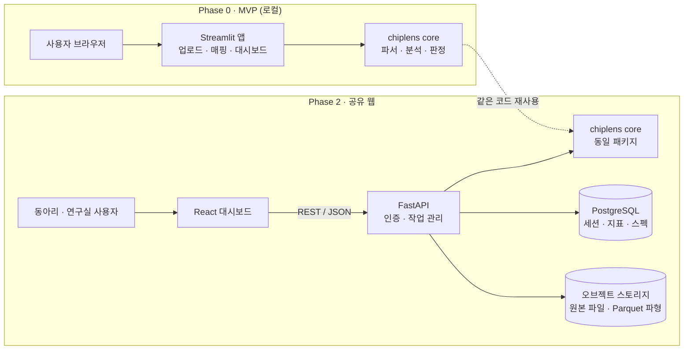
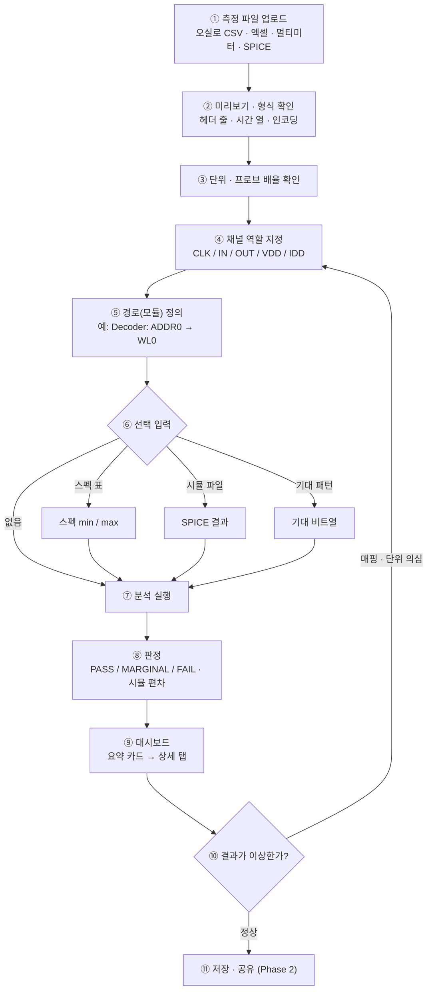
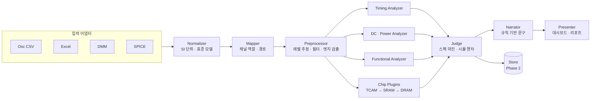
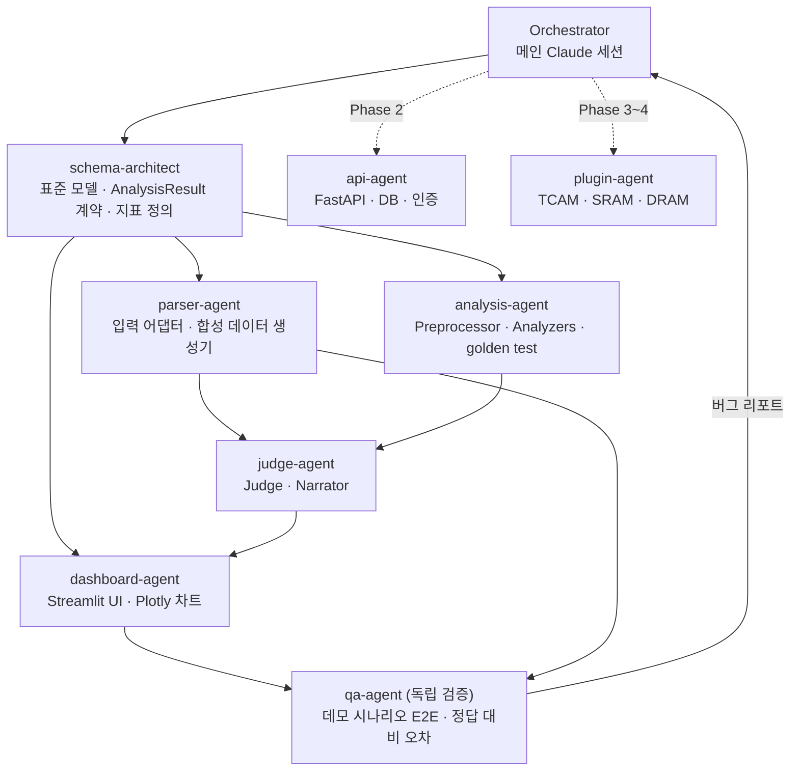

# 칩 성능 테스트·분석 웹 기획서

> 가칭 **ChipLens** · v0.1 · 2026-11-05 · 작성: Hanseo (with Claude)
> 상태: 기획 확정 / 코드 미작성

---

## 0. 한눈에 보기

**한 문장 정의** — PCB에 실장한 칩을 오실로스코프·멀티미터로 측정한 파일을 올리고 채널 역할만 지정하면, 타이밍·DC·기능 지표를 자동 계산해 스펙과 시뮬레이션 대비로 판정하고 한 화면 대시보드로 보여주는 웹.

| # | 결정 항목 | 결정 내용 |
|---|---|---|
| ① | 사용 범위 | 동아리·연구실 공유 웹 (로그인 + 측정 이력 저장). 단, MVP는 로컬 단일 사용자 |
| ② | 입력 데이터 | 오실로스코프 CSV, 엑셀 정리표(.xlsx), 멀티미터 DC 측정값, SPICE 시뮬레이션 결과 — 4종 모두 |
| ③ | 핵심 분석 | 디지털 타이밍 · DC/전력 · 기능 검증을 각 2~3개 대표 지표로 얕게 전부 |
| ④ | 판정 기준 | 스펙 입력 → Pass/Fail + 마진, 시뮬레이션 대비 편차 |
| ⑤ | 해석 방식 | 규칙 기반만 (LLM 미사용 → 결정적·재현 가능, 런타임 API 비용 0) |
| ⑥ | 채널 매핑 | 업로드할 때마다 UI에서 채널 역할 지정 |
| ⑦ | 기술 스택 | 분석 코어 = 순수 Python 패키지 / MVP = Streamlit → 공유 단계 = FastAPI + React |
| ⑧ | 칩별 확장 | 첫 전용 모듈 = TCAM, 구조 = 플러그인 + YAML 지표 정의 |
| ⑨ | 구조도 범위 | 서비스 내부 처리 모듈 + 개발용 Claude 서브에이전트 둘 다 |
| ⑩ | 테스트 데이터 | 실측 파일 없음 → 정답을 심어 둔 합성 데이터로 MVP 검증 |
| ⑪ | 대시보드 첫 화면 | 판정 요약 카드 (Pass/Fail · 최악 마진 · 시뮬 편차 · 기능 일치율) |

---

## 1. 개요

### 1.1 대상 사용자
- **1차**: KUSEM·연구실에서 제작된 칩(예: My Chip 제작 서비스 칩)을 PCB에 올려 측정하는 학부생·대학원생
- **2차**: 같은 칩을 여러 개·여러 조건으로 측정해 품질을 비교하려는 팀

### 1.2 해결하려는 문제
- 측정 데이터가 장비별 CSV, 손으로 정리한 엑셀, 시뮬레이션 출력으로 흩어져 있다
- tpd·rise time 같은 지표를 매번 오실로스코프 커서나 엑셀로 계산한다 → 느리고, 사람마다 정의(50%? 10–90%? 기준 전압은 VDD? 실측 레벨?)가 달라 결과가 맞지 않는다
- "스펙을 만족하는가", "시뮬레이션과 얼마나 다른가"를 한 번에 보기 어렵다

### 1.3 성공 기준

| 구분 | 기준 |
|---|---|
| 기능 | 파일 첨부 → 채널 지정 → 지표 계산 → 판정 → 대시보드까지 한 흐름으로 동작 |
| 정확도 | 합성 데이터에 심어 둔 정답 대비 타이밍 지표 오차 ≤ 3% (임계 교차점 선형 보간 적용) |
| 재현성 | 같은 파일·같은 매핑·같은 스펙 → 항상 같은 결과 |
| 속도 | 2만 포인트 × 4채널 기준, 분석 실행부터 판정 카드 표시까지 3초 이내 |
| 설명 가능성 | 모든 지표에 "어느 엣지에서, 어떤 기준 전압으로 쟀는지"가 파형 위 마커로 보임 |

---

## 2. 서비스 정의

### 2.1 기능 범위

| 구분 | 기능 |
|---|---|
| 꼭 필요 | 포트별 시간–전압/전류 데이터 업로드 (4종 형식) |
| 꼭 필요 | 채널 역할 지정, 단위·프로브 배율 확인 |
| 꼭 필요 | 동작 특성 확인: 파형 시각화, 논리 레벨, 기대 패턴 대비 기능 일치 |
| 꼭 필요 | 타이밍 확인: rise/fall, tpd, 주기·듀티, 가용 슬랙 |
| 꼭 필요 | 모듈별 타이밍·마진: 사용자가 정의한 **경로(=모듈)** 단위로 지표·마진 집계 |
| 꼭 필요 | 판정: 스펙 Pass/Fail + 마진, 시뮬레이션 대비 편차 |
| 꼭 필요 | 규칙 기반 요약 문구, 판정 요약 카드 중심 대시보드 |
| 나중 | 칩 전용 분석 플러그인: TCAM → SRAM → DRAM |
| 나중 | 공유 웹: 로그인, 측정 이력 DB, 그룹(동아리/연구실) 권한 |
| 나중 | setup/hold 실제 마진(Shmoo), Fmax, Vmin, 지터, 글리치 |
| 나중 | 장비별 CSV 자동 인식, ngspice raw 바이너리, PDF 리포트 |

### 2.2 입력 데이터 4종

| 형식 | 담긴 정보 | 파싱 시 주의점 | MVP 처리 |
|---|---|---|---|
| 오실로스코프 CSV | 시간 + CH1~CH4 전압 (전류 프로브 사용 시 전류) | 장비마다 메타데이터 줄 수·단위 행·열 구성이 다름 / 시간 열 없이 시작 시각 + 샘플 간격만 주는 형식 / 채널별로 파일이 나뉘는 경우 / 프로브 감쇠비(×10) 미반영 | 범용 표 리더 + "헤더 몇 줄 건너뛰기"·열 선택 UI |
| 엑셀 정리표 (.xlsx) | 시트별 조건(VDD, 온도), 포트별 값 | 병합 셀, 한글 헤더, 헤더 안 단위("전류(mA)"), 한 시트에 여러 표 | 시트·헤더 행·열 선택 UI, 헤더에서 단위 추출 |
| 멀티미터 DC | V–I 스윕 점, IDDQ·누설 같은 단일값 | 시간 정보 없음 → DC 전용, 단위 접두사(µ, m) 혼재 | CSV/엑셀로 받아 DC 스윕 테이블로 처리 |
| SPICE 결과 | 이상적 파형 (비교 기준선) | ngspice `wrdata`는 기본적으로 벡터마다 시간 열이 반복됨 → `wr_singlescale`, `wr_vecnames` 옵션 권장 / raw 바이너리는 별도 파서 필요 | 텍스트·CSV 출력만 (raw는 Phase 1) |

> 공통: 한글 Windows에서 저장된 CSV는 cp949 인코딩일 수 있음 → UTF-8 실패 시 cp949로 재시도.

### 2.3 내부 표준 데이터 모델

모든 입력은 파서를 지나면 아래 표준 형태로 바뀌고, 분석기는 이 표준 형태만 본다. 입력 형식이 늘어나도 분석 코드는 그대로다.

| 객체 | 주요 필드 | 설명 |
|---|---|---|
| `Session` | chip_id, 측정일, 조건(VDD·온도·주파수), 장비 정보(대역폭·샘플링), source(measured / sim) | 측정 1회 단위 |
| `Waveform` | channel_id, 역할, 시간 배열(s), 값 배열(V 또는 A), 샘플 간격 | SI 단위로 정규화 |
| `DCSweep` | x(V), y(A), 조건 | 멀티미터·엑셀 DC 데이터 |
| `ChannelMap` | 채널 → 역할(CLK, IN, OUT, EN, DATA, VDD, IDD …), 논리 VDD | 업로드마다 UI에서 지정 |
| `Path` | 이름(=모듈명), 입력 채널, 출력 채널, 엣지 극성 | "모듈별 타이밍"의 단위 |
| `Spec` | metric_id, path, min, max, 단위 | 사용자 입력 |
| `AnalysisResult` | metric_id, path, 값, 통계(mean/min/max/σ, 엣지 개수), 근거(사용한 엣지 시각·기준 전압), 판정, 마진, 시뮬값, 편차 | **분석 코어와 UI 사이의 계약(JSON)** |

### 2.4 범용 지표 카탈로그

**디지털 타이밍**

| 지표 | 정의 | 필요한 역할 | 단계 |
|---|---|---|---|
| Rise / Fall time | 출력 low→high의 10%→90% (fall은 90%→10%). 기준 = 실측 high/low 레벨 | OUT | MVP |
| tpd (tpLH, tpHL) | 입력 50% 교차 → 출력 50% 교차. 엣지마다 계산 후 통계 | IN, OUT (경로) | MVP |
| 주기·주파수·듀티 | 연속 상승 엣지 간격, high 구간 비율 | CLK | MVP |
| 가용 슬랙 (단일 캡처) | 데이터 전이 ↔ 클럭 엣지 사이 시간 (setup 쪽 / hold 쪽) | CLK, DATA | MVP — "이 캡처에서의 여유"로 표기 |
| setup/hold 마진 | 데이터–클럭 지연을 스윕한 여러 캡처에서 기능이 깨지는 경계 | CLK, DATA, OUT + 스윕 세트 | Phase 1 |
| Fmax | 주파수 스윕에서 기능 통과 최대 주파수 | 스윕 세트 | Phase 1 |
| 엣지 지터 | 엣지 시각 분포의 σ | CLK / OUT | Phase 1 |

**DC·전력**

| 지표 | 정의 | 필요한 데이터 | 단계 |
|---|---|---|---|
| VOH / VOL | 출력 high/low 안정 구간의 대표 전압 (히스토그램 두 봉우리) | OUT 파형 | MVP |
| IDDQ / 누설 전류 | 정적 상태 공급 전류 | 멀티미터 값 | MVP |
| 평균 전력 | VDD × 평균 IDD | VDD, IDD | MVP |
| I–V 곡선 | DC 스윕 그래프 (누설 영역은 로그 축) | DC 스윕 | MVP |
| Vmin | VDD 스윕에서 기능 통과 최소 전압 | VDD 스윕 세트 | Phase 1 |
| 노이즈 마진 NMH / NML | VTC에서 VIH / VIL 추출 | 입력 스윕 | Phase 1 |

**기능 검증**

| 지표 | 정의 | 단계 |
|---|---|---|
| 출력 비트열 | 지정한 클럭 엣지에서 출력을 샘플링해 0/1 판정 (임계 = 논리 VDD/2) | MVP |
| 기대 패턴 일치율 | 사용자가 입력한 기대 비트열 대비 일치율 · 첫 불일치 위치 | MVP |
| 글리치 | 최소 펄스폭보다 짧은 펄스 검출 | Phase 1 |

### 2.5 판정 로직 (규칙 기반)

**스펙 판정과 마진**
- 상한 스펙(값 ≤ max, 예: tpd): 마진 = (max − 값) / max × 100%
- 하한 스펙(값 ≥ min, 예: VOH): 마진 = (값 − min) / min × 100%
- 범위 스펙: 두 마진 중 작은 값
- 등급: **PASS** 마진 ≥ 10% · **MARGINAL** 0 ~ 10% · **FAIL** < 0 (10%는 설정값)
- 여러 엣지에서 측정된 지표는 **최악값(worst case)으로 판정**, 평균은 참고로 표시

**시뮬레이션 대비 편차**
- 시뮬레이션 파형에도 **같은 매핑·같은 알고리즘**을 적용해 지표를 뽑고, 지표끼리 비교: 편차 = (실측 − 시뮬) / 시뮬 × 100%
- 파형 겹쳐 보기는 기준 엣지(예: CLK 첫 상승)로 시간축을 맞춘 뒤 **표시용으로만** 사용
- 허용 편차(기본 ±20%) 초과 시 경고, PCB·프로브 지연 보정 오프셋 입력란 제공

**요약 문구 규칙 (예시)**

| 조건 | 문구 템플릿 |
|---|---|
| 지표 FAIL | "{경로} {지표} {값} — 스펙 {스펙} 위반 (FAIL)" |
| 모든 타이밍 지표가 시뮬 대비 비슷한 비율로 느림 | "전 경로 공통 지연 증가 → 측정 경로(패드·PCB·프로브) 지연, VDD 강하, 공정 코너 가능성" |
| 특정 경로만 크게 느림 | "{경로}만 시뮬 대비 +{편차}% → 해당 경로 부하·배선 기생 확인 필요" |
| 측정 rise time < 2 × (0.35 / 장비 대역폭) | "측정값이 오실로스코프 대역폭 한계에 가까움 → 실제 값은 더 짧을 수 있음" |
| 기능 불일치 | "{n}번째 사이클에서 첫 불일치 (기대 {e}, 측정 {m})" |

### 2.6 채널 매핑 UI (업로드마다 지정)
1. 파일 업로드 → 앞부분 표 미리보기 + 채널별 작은 파형
2. 헤더 줄 수 · 시간 열 · 단위 · 프로브 배율 확인 (자동 추정값을 기본으로 보여주고 사람이 수정)
3. 채널마다 역할 드롭다운: CLK / IN / OUT / EN / DATA / VDD / IDD / 사용 안 함
4. 논리 VDD, 오실로스코프 대역폭 입력
5. 경로(=모듈) 정의: 이름 + 입력 채널 → 출력 채널 (예: `Decoder: ADDR0 → WL0`)
6. (선택) 기대 출력 비트열, 스펙 표, 시뮬 파일 첨부

> 편의 기능(나중): "직전 매핑 불러오기" 버튼 — 템플릿 관리 없이 반복 입력만 줄임

### 2.7 칩 전용 플러그인 (TCAM 먼저)

**구조** — 칩 타입마다 `analyzer`(계산 로직) 1개 + `YAML`(필요 채널 역할, 지표 정의, 기본 스펙, 대시보드 패널) 1개. 새 칩 추가 = 파일 2개 추가, 범용 코어는 수정하지 않음.

YAML이 담을 내용 (형식 예시):

```yaml
chip_type: tcam
required_roles: [CLK, SEARCH_EN, KEY, MATCH_OUT, VDD, IDD]
metrics:
  - id: search_delay
    label: Search delay
    definition: "SEARCH_EN 50% 상승 → MATCH_OUT 50% 교차"
    unit: s
    default_spec: {max: 10e-9}
  - id: match_vector_accuracy
    label: Match 벡터 정확도
    unit: "%"
    default_spec: {min: 100}
panels: [verdict_cards, match_grid, search_delay_bar]
```

**TCAM 전용 지표**

| 지표 | 정의 | 측정 가능 조건 |
|---|---|---|
| Search delay | 검색 시작 엣지 → match 출력 유효 | match 출력이 핀으로 나와 있어야 함 |
| 최악 mismatch 판정 시간 | 1비트만 다른 key 검색 시 판정까지 시간 (NOR형 ML에서 가장 느린 방전) | 위와 동일 + 1비트 mismatch 패턴 |
| ML precharge 시간 | precharge 신호 → ML 90% 복귀 | ML 노드가 아날로그 테스트 핀으로 나와 있을 때만 |
| ML 센싱 마진 | match 시 ML 유지 전압 − mismatch 시 ML 전압 | 위와 동일 |
| Search 에너지 | 검색 1회 구간 VDD × IDD 적분 | IDD를 시간 분해능 있게 측정할 때 (전류 프로브 / 션트 저항) |
| Match 벡터 정확도 | 저장 word × search key 조합별 기대 match 벡터와 비교, 4×4 그리드 표시 | 기능 패턴 |
| Don't-care 동작 | X 비트가 마스킹되어 match 되는지 | 기능 패턴 |
| Write / read-back | 셀 write 후 read-back 일치 | read 경로가 있을 때 |

> **Phase 3 착수 전 확인**: My Chip 4×4 TCAM의 핀맵에서 ML·센스앰프 출력 중 어떤 노드가 패드로 나와 있는지가 측정 가능한 지표를 결정한다.

**이후 플러그인 지표 후보**
- **SRAM**: read/write access time, write margin, read 안정성(read disturb), data retention 전압
- **DRAM**: tRCD · tRP · tRAS, retention time 분포, 센싱 마진, refresh 주기 의존성

---

## 3. 기술 병목 분석

| # | 병목 | 왜 문제인가 | 대응 | 심각도 | 대응 시점 |
|---|---|---|---|---|---|
| B1 | 입력 형식 이질성 | 4종 형식 × 장비별 CSV 방언 × 자유 형식 엑셀. 개발 시간이 가장 많이 들어가는 곳 | 표준 데이터 모델 + 형식별 어댑터 분리. MVP는 "범용 표 리더 + 사람이 확인하는 UI"로 자동 인식을 대신함 | 높음 | MVP(범용) → Phase 1(장비별) |
| B2 | 엣지 검출 견고성 | 노이즈·링잉·오버슈트·글리치로 임계 교차가 여러 번 잡힘 → tpd가 엉뚱하게 나옴 | 히스테리시스 임계, 최소 펄스폭 필터, 선택적 스무딩, high/low 레벨을 히스토그램으로 추정, 교차점 선형 보간 | 높음 | MVP |
| B3 | 정답 데이터 부재 | 실측 파일이 없어 분석기가 맞는지 확인할 방법이 없음 | 정답값을 심은 합성 데이터 생성 → golden test (부록 A) | 높음 | MVP |
| B4 | 실측–시뮬 정렬 | 트리거 위치·샘플 간격이 다르고 PCB·프로브 지연이 포함됨 | 파형끼리가 아니라 **지표끼리** 비교. 기준 엣지 정렬은 표시용. 보정 오프셋 입력 | 중간 | MVP |
| B5 | 관측 가능성 (물리적 한계) | 칩 내부 모듈 타이밍은 외부 핀에서만 보임 → 패드 드라이버·PCB·프로브 지연이 섞임 | "모듈별 타이밍"을 **관측 가능한 경로** 기준으로 정의. 테스트 구조(버퍼 체인 등)로 측정 경로 지연을 따로 재서 보정 | 높음 (소프트웨어로 해결 불가) | 설계 원칙 |
| B6 | 측정 장비 한계 | 측정 rise time ≈ √(신호² + 오실로² + 프로브²), 오실로 rise time ≈ 0.35 / 대역폭 (예: 100 MHz → 약 3.5 ns) | 장비 대역폭을 입력받아 한계 근처 측정값에 경고 | 중간 | MVP |
| B7 | setup/hold 마진의 정의 | 실제 마진은 단일 파형으로 나오지 않고 지연 스윕(Shmoo)이 필요 | MVP는 "가용 슬랙"으로 이름을 구분. Phase 1에서 스윕 세트 업로드 + Shmoo 히트맵 | 중간 | Phase 1 |
| B8 | 대용량 파형 | 오실로 CSV 수백만 포인트 → 업로드 한도(Streamlit 기본 200 MB), 브라우저 렌더링 부하 | 계산은 원본, 그리기는 min-max / LTTB 다운샘플링 + WebGL 차트, 저장은 Parquet | 중간 | Phase 1 |
| B9 | 단위·배율 오류 | mV/V, µA/A, 프로브 ×10 미반영 → 지표가 10배·1000배 틀림 | 업로드 직후 단위·배율 확인 단계 필수, 값 범위가 비정상이면 경고 | 중간 | MVP |
| B10 | 지표 정의 불일치 | tpd 기준이 50%인지, 기준 전압이 VDD인지 실측 레벨인지 사람마다 다름 | 지표 정의를 문서·YAML에 명시, 대시보드에 정의 툴팁 | 중간 | MVP(문서) → Phase 1(YAML) |
| B11 | 공유 웹 전환 | 인증·권한·저장소, 미공개 칩 데이터 보안 | Phase 2에서 FastAPI + DB + 오브젝트 스토리지, 그룹 단위 권한 | 중간 | Phase 2 |
| B12 | Streamlit → React 이전 비용 | UI 코드에 분석 로직이 섞이면 이전 때 다시 짜야 함 | 분석 코어를 UI 무관 패키지로, 결과는 `AnalysisResult` JSON으로 고정 | 낮음 (초기 설계로 예방) | MVP부터 |

> 가장 큰 리스크는 소프트웨어가 아니라 **B5·B6(관측 가능성과 장비 한계)**다. 웹이 아무리 정확해도 측정 셋업이 보지 못하는 신호는 분석할 수 없으므로, 칩 측정 계획(어떤 노드를 어떤 장비로)을 기획과 함께 관리해야 한다.

---

## 4. 2시간 MVP (Phase 0)

### 4.1 범위

**포함 (In)**
- Streamlit 단일 앱, 로컬 실행, 로그인·DB 없음 (공유 웹 구조는 코어 분리로 미리 대비)
- 입력 4종: 범용 표 리더(CSV · xlsx · 텍스트) + 데이터 종류 선택(파형 / DC 스윕 / 시뮬 파형)
- 채널 매핑 UI: 역할 드롭다운, 단위·배율, 논리 VDD, 장비 대역폭, 경로(모듈) 정의
- 지표
  - 타이밍: rise/fall, tpd(경로별), 주기·듀티, 가용 슬랙
  - DC·전력: VOH/VOL, IDDQ, 평균 전력, I–V 곡선
  - 기능: 출력 비트열, 기대 패턴 일치율
- 판정: 스펙 표 입력 → PASS / MARGINAL / FAIL + 마진, 시뮬 파일 첨부 시 지표별 편차
- 규칙 기반 요약 문구 (2.5의 규칙 5개)
- 대시보드: 판정 요약 카드 → 마진 바 → 탭(파형 · 타이밍 · DC · 기능 · 시뮬 비교)
- 합성 데이터 생성기 + golden test

**제외 (Out)** — TODO로만 남김
- 로그인·DB·공유, 장비별 CSV 자동 인식, ngspice raw, Shmoo / Fmax / Vmin, 대용량 다운샘플링, 칩 간 통계, TCAM 플러그인, PDF 리포트

### 4.2 데모 시나리오 (MVP 완료 확인용)
1. 합성 오실로 CSV(4채널: CLK, IN, OUT, IDD) 업로드
2. 채널 역할 지정, 경로 `Buffer: IN → OUT` 정의, 논리 VDD 1.8 V, 대역폭 500 MHz 입력
3. 스펙 입력: tpd ≤ 8 ns, rise ≤ 4 ns, VOH ≥ 1.6 V, IDDQ ≤ 2.5 µA
4. 합성 시뮬 CSV 첨부
5. 분석 실행 → tpd·rise PASS(마진 25%), VOH MARGINAL(마진 9.4%), 시뮬 대비 tpLH +33% · rise +50% 경고 표시
6. 합성 멀티미터 xlsx 업로드 → I–V 곡선 + IDDQ PASS(마진 40%)
7. 기대 비트열 입력 → 일치율 100% / 오류 주입 파일에서 37번째 사이클 첫 불일치 표시
8. 대역폭을 100 MHz로 바꿔 재실행 → rise time에 장비 한계 경고 표시

### 4.3 타임박스 (Claude Code + 서브에이전트 기준)

| 시간 | 작업 | 담당 에이전트 |
|---|---|---|
| 0:00 – 0:15 | 표준 데이터 모델 · `AnalysisResult` 계약 · 지표 정의 확정 | schema-architect |
| 0:15 – 0:45 | **병렬**: 범용 파서 + 합성 데이터 생성기 / 분석 코어(타이밍·DC·기능) / 목업 결과로 대시보드 뼈대 | parser · analysis · dashboard |
| 0:45 – 1:15 | 판정(스펙·시뮬 편차) + 요약 문구, golden test 통과 | judge · analysis |
| 1:15 – 1:40 | 대시보드에 실제 결과 연결, 채널 매핑 UI 완성 | dashboard |
| 1:40 – 2:00 | 데모 시나리오 E2E 검증, 수정 | qa |

### 4.4 완료 기준
- [ ] 데모 시나리오 1~8이 끊기지 않고 동작
- [ ] golden test: tpd · rise/fall 정답 대비 오차 ≤ 3%, VOH/VOL 오차 ≤ 1%, 일치율·첫 불일치 위치 정확
- [ ] 같은 입력 2회 실행 → 결과 동일
- [ ] 분석 코어 패키지가 Streamlit을 import하지 않음 (Phase 2 이전 대비)

---

## 5. 단계별 로드맵

| 단계 | 목표 | 주요 산출물 | 기간(대략) |
|---|---|---|---|
| Phase 0 | 2시간 MVP | 4장 범위 | 2시간 |
| Phase 1 | 범용 분석 완성 | 장비별 CSV 어댑터(실제 사용 장비부터), ngspice raw, 엣지 검출 고도화, 스윕 세트 업로드 → Shmoo · Fmax · Vmin, 지표 정의 YAML화, 다운샘플링, 모듈별 타이밍 맵, PDF 리포트 | 1 ~ 2주 |
| Phase 2 | 공유 웹 | FastAPI + React 이전, 로그인(그룹: 동아리/연구실), DB(프로젝트 → 칩 → 측정 세션), 파형 Parquet 저장, 측정 이력·재분석, 칩 간 비교(선택) | 2 ~ 3주 |
| Phase 3 | TCAM 플러그인 | 2.7 지표, match 벡터 그리드, search delay 막대 | 1주 (핀맵 확인 후) |
| Phase 4 | SRAM · DRAM 플러그인 | 플러그인당 analyzer + YAML + golden 데이터 | 플러그인당 1주 |

---

## 6. 시스템 아키텍처

### 6.1 설계 원칙
1. **분석 코어는 UI와 무관한 순수 Python 패키지** — Streamlit에서도, FastAPI에서도 그대로 import
2. 모든 입력은 **표준 데이터 모델로 변환된 뒤에만** 분석기로 간다
3. 분석기 출력은 **`AnalysisResult` JSON 하나로 고정** — 대시보드 · 리포트 · DB가 모두 이것만 읽는다
4. 칩 전용 분석은 **플러그인 + YAML**로 붙이고 코어는 수정하지 않는다
5. 모든 판정은 **결정적 규칙** — 같은 입력이면 같은 출력

### 6.2 MVP → 공유 웹 구조



### 6.3 디렉터리 구조 (안)

```
chiplens/
├─ core/                 # UI 무관 분석 코어 (순수 Python)
│  ├─ models/            # 표준 데이터 모델, AnalysisResult 계약
│  ├─ adapters/          # osc_csv, excel, dmm, spice
│  ├─ preprocess/        # 레벨 추정, 필터, 엣지 검출
│  ├─ analyzers/         # timing, dc_power, functional
│  ├─ judge/             # spec_margin, sim_compare, narrator(규칙 문구)
│  └─ plugins/           # tcam/ (analyzer + tcam.yaml), sram/, dram/
├─ app_streamlit/        # Phase 0 UI
├─ api/                  # Phase 2 FastAPI
├─ web/                  # Phase 2 React
├─ synth/                # 합성 데이터 생성기 + 정답표
├─ tests/golden/         # 정답 대비 검증
└─ .claude/agents/       # 개발용 서브에이전트 정의
```

---

## 7. 워크플로우 (사용자 작업 흐름)



---

## 8. 서브에이전트 구조도

### 8.1 서비스 내부 처리 모듈 (데이터 흐름)



| 모듈 | 하는 일 | 입력 → 출력 |
|---|---|---|
| 입력 어댑터 | 형식별 파일 읽기 (인코딩·헤더·시트 처리) | 파일 → 원시 표 |
| Normalizer | SI 단위 변환, 프로브 배율 적용, 시간축 생성 | 원시 표 → `Waveform` / `DCSweep` |
| Mapper | 채널 역할·경로 부착 | 표준 모델 + 사용자 입력 → 매핑된 세션 |
| Preprocessor | high/low 레벨 추정, 히스테리시스 엣지 검출, 선택적 스무딩 | 파형 → 엣지 목록 · 레벨 |
| Analyzers | 지표 계산 + 근거(엣지 시각·기준 전압) 기록 | 엣지·레벨 → 지표 값 |
| Chip Plugins | 칩 전용 지표 (YAML 정의 기반) | 엣지·레벨 → 칩 지표 |
| Judge | 스펙 마진·등급, 시뮬 편차 | 지표 + 스펙 + 시뮬 지표 → `AnalysisResult` |
| Narrator | 2.5 규칙으로 요약 문구 생성 | `AnalysisResult` → 문장 |
| Presenter | 카드 · 차트 · 표 렌더링 | `AnalysisResult` → 화면 |
| Store (Phase 2) | 세션 · 결과 · 원본 저장, 이력 조회 | `AnalysisResult` ↔ DB |

### 8.2 개발용 Claude 서브에이전트



| 에이전트 | 맡는 모듈 (8.1) | 산출물 | 선행 조건 | 건드리지 않는 영역 |
|---|---|---|---|---|
| schema-architect | 표준 모델, 계약 | `core/models`, 지표 정의 문서 | 없음 (가장 먼저) | 구현 코드 |
| parser-agent | 입력 어댑터, Normalizer | `core/adapters`, `synth/` | 계약 확정 | 분석·UI |
| analysis-agent | Preprocessor, Analyzers | `core/preprocess`, `core/analyzers`, `tests/golden` | 계약 확정 | 파서·UI |
| judge-agent | Judge, Narrator | `core/judge` | 분석 결과 형식 확정 | 분석 알고리즘 |
| dashboard-agent | Mapper UI, Presenter | `app_streamlit/` | 계약 확정 (목업 결과로 먼저 시작) | `core/` 전체 |
| qa-agent | 전체 검증 | 테스트 리포트, 버그 목록 | 각 모듈 완료 | 구현 코드 수정 (리포트만) |
| api-agent (Phase 2) | Store, API | `api/`, DB 스키마 | MVP 완료 | `core/` |
| plugin-agent (Phase 3~4) | Chip Plugins | `core/plugins/<chip>/` | Phase 1 YAML 구조 | 범용 코어 |

**운용 규칙**
- 계약(`core/models`)은 schema-architect만 수정한다. 다른 에이전트가 계약 변경이 필요하면 Orchestrator에 요청
- qa-agent는 구현에 참여하지 않고, 데모 시나리오와 부록 A 정답표만으로 검증한다 (작업이 스스로를 채점하지 않도록)
- dashboard-agent는 계약만 확정되면 목업 `AnalysisResult`로 먼저 화면을 만들어 병렬 진행
- 정의 위치: `.claude/agents/<에이전트명>.md`

---

## 9. 대시보드 구성

### 9.1 화면 구조 (판정 요약 카드 우선)

```
[헤더]  칩 ID · 세션 조건(VDD · 온도 · 주파수) · 첨부 파일 목록 · [매핑 수정]
──────────────────────────────────────────────
[카드1 전체 판정] [카드2 최악 마진] [카드3 시뮬 최대 편차] [카드4 기능 일치율]
──────────────────────────────────────────────
[지표별 마진 바 차트]  경로(모듈)별 그룹, 등급별 색 + 기호
──────────────────────────────────────────────
[탭]  파형 | 타이밍 | DC·전력 | 기능 | 시뮬 비교 | 원본 데이터
  └ 선택한 탭의 차트 + 지표 표
──────────────────────────────────────────────
[요약 문구]  규칙 기반 3~5줄
```

**카드 예시 (부록 A 데모 데이터 기준)**

| 카드 | 표시 내용 |
|---|---|
| 전체 판정 | ✓ PASS 4 · ! MARGINAL 1 · ✕ FAIL 0 |
| 최악 마진 | ! VOH 1.75 V (하한 1.6 V, 마진 9.4%) |
| 시뮬 최대 편차 | rise(Buffer) +50% · tpLH +33% (허용 ±20% 초과 경고) |
| 기능 일치율 | ✓ 100% (40/40 사이클) |

### 9.2 탭별 차트

| 탭 | 차트 | 내용 |
|---|---|---|
| 파형 | 다채널 라인 차트 (공유 시간축, 줌) | 측정 마커: 50% 교차점, 10/90% 점, tpd 구간 음영 |
| 타이밍 | 경로별 지표 표 + 엣지별 분포(박스/스트립 플롯) | tpLH / tpHL, rise / fall, 가용 슬랙 |
| DC·전력 | I–V 곡선(누설 영역 로그 축), IDD 시간 파형 | IDDQ, 평균 전력 카드 |
| 기능 | 디지털 타이밍 다이어그램(0/1 레인) | 기대값과 다른 비트를 빨간색으로 강조 |
| 시뮬 비교 | 실측·시뮬 파형 겹쳐 보기, 지표별 편차 막대 | 허용 편차 밴드 표시 |
| 원본 데이터 | 정규화된 표 + 매핑·단위 정보 | 모든 숫자의 근거 추적용 |
| (Phase 1) Shmoo | 히트맵 (지연 × 전압 / 주파수 × 전압) | setup/hold 마진, Fmax, Vmin |
| (Phase 2) 칩 간 비교 | 분포 히스토그램 | 칩별 이상치 표시 |
| (Phase 3) TCAM | 4×4 match 그리드, word별 search delay 막대 | 정답/오답 셀 색 표시 |

### 9.3 표시 규칙과 인터랙션
- 등급 색: PASS 초록 ✓ · MARGINAL 주황 ! · FAIL 빨강 ✕ · 스펙 없음 회색 — **색만으로 구분하지 않고 기호 병기**
- 카드 클릭 → 해당 지표 탭으로 이동 + 파형에서 해당 엣지 하이라이트
- 마커에 마우스를 올리면 엣지 시각 · 기준 전압 표시
- 모든 지표 이름 옆에 정의 툴팁 (B10 대응)

---

## 10. 추천 MCP · API · 스킬 · 라이브러리

### 10.1 라이브러리

| 라이브러리 | 용도 | 단계 |
|---|---|---|
| pandas + openpyxl | CSV · 엑셀 읽기 | MVP |
| numpy + scipy.signal | 교차점 보간, Savitzky–Golay 스무딩, 레벨 추정 | MVP |
| plotly | 파형 · 마진 바 · I–V (WebGL 모드), React 단계에서도 Plotly.js로 이어 사용 | MVP |
| streamlit | MVP UI | MVP |
| pydantic | 표준 데이터 모델 · `AnalysisResult` 스키마 검증 | MVP |
| pytest | golden test | MVP |
| PyYAML | 지표·플러그인 정의 | Phase 1 |
| pyarrow | Parquet 저장 | Phase 1 ~ 2 |
| spicelib (또는 유사 라이브러리) | ngspice raw 읽기 — 지원 범위는 착수 시 확인 | Phase 1 |
| FastAPI + SQLAlchemy + PostgreSQL | 공유 웹 백엔드 | Phase 2 |
| React + TanStack Query + Plotly.js | 공유 웹 프론트 | Phase 2 |

### 10.2 MCP (개발 단계에서 Claude Code에 연결)

| MCP | 용도 | 단계 |
|---|---|---|
| GitHub MCP | 이슈·PR 단위로 서브에이전트 작업 관리 | MVP ~ |
| Playwright MCP | 대시보드를 실제 브라우저로 띄워 데모 시나리오 클릭·스크린샷 검증 (qa-agent) | MVP ~ |
| Context7 MCP | Streamlit · Plotly · FastAPI 최신 문서 참조 → API 변경으로 인한 오류 감소 | MVP ~ |
| Supabase MCP 또는 PostgreSQL MCP | DB 스키마·마이그레이션 (Supabase면 인증·스토리지까지 한 번에) | Phase 2 |

> 설치 방법과 정확한 이름은 연결 시점의 공식 문서로 확인.

### 10.3 API
- **런타임 외부 API 없음** — 규칙 기반 해석을 골랐으므로 비용 0, 오프라인 동작 가능
- Phase 2 로그인: 학교 Google 계정 OAuth 또는 Supabase Auth

### 10.4 Claude 스킬

| 스킬 | 용도 |
|---|---|
| skill-creator | 커스텀 스킬 `chip-plugin-builder` 제작 — "새 칩 플러그인 = analyzer + YAML + golden 데이터 + 대시보드 패널" 절차를 고정해 SRAM · DRAM 추가 때 재사용 |
| xlsx | 합성 멀티미터·엑셀 테스트 파일 생성 (병합 셀 · 한글 헤더 같은 까다로운 케이스 포함) |
| frontend-design | Phase 2 React 대시보드 시각 방향 |
| pdf | Phase 1 측정 리포트 PDF 내보내기 |

---

## 11. 미결정 사항과 다음 액션

### 11.1 미결정 사항

| 항목 | 정할 시점 |
|---|---|
| 실제 사용할 오실로스코프 · 멀티미터 모델 | Phase 1 착수 시 (장비별 어댑터 우선순위 결정) |
| TCAM 칩 핀맵 · 관측 가능 노드 | Phase 3 전 |
| MARGINAL 임계(10%) · 시뮬 허용 편차(±20%) 기본값 | MVP 데모 후 조정 |
| 배포 위치 (학교·연구실 서버 vs 클라우드), 데이터 보관 정책 | Phase 2 전 |
| 칩 간 비교(통계) 포함 여부 | Phase 2 (측정 이력이 쌓이면 자연스럽게 가능) |

### 11.2 다음 액션
1. 부록 A 정답 사양 확인 · 수정
2. 부록 B 프롬프트로 MVP 착수
3. My Chip TCAM 측정 계획(어떤 핀을 어떤 장비·채널로) 정리 → Phase 3 입력

---

## 부록 A. 합성 데이터 정답 사양 (golden)

**A-1. 가짜 실측 오실로 CSV (`synth_scope.csv`)**

| 항목 | 값 |
|---|---|
| 샘플링 / 길이 | 5 GS/s (0.2 ns) / 4 µs → 채널당 20,000점 |
| CLK | 10 MHz, 듀티 50%, rise/fall 1 ns |
| IN | 의사랜덤 비트열, CLK 하강 엣지에 맞춰 변화 (40비트) |
| OUT | IN을 지연·성형한 파형: tpLH 6.0 ns, tpHL 5.5 ns, rise 3.0 ns, fall 2.5 ns (10–90%), VOH 1.75 V, VOL 0.05 V |
| IDD | 평균 120 µA, 출력 전이 순간 스파이크 |
| 노이즈 | 가우시안 σ 10 mV + 5% 오버슈트 링잉 (엣지 검출 견고성 확인용) |
| 기능 정답 | CLK 상승 엣지에서 샘플링한 OUT = IN 비트열 → 일치율 100% |

**A-2. 오류 주입 파일 (`synth_scope_err.csv`)** — A-1과 동일하되 37번째 사이클 OUT 비트 반전 → 첫 불일치 위치 37

**A-3. 시뮬 파형 (`synth_sim.csv`, ngspice wrdata 형식 흉내)** — 노이즈 없음, tpLH 4.5 ns, tpHL 4.2 ns, rise 2.0 ns, fall 1.8 ns, VOH 1.80 V, VOL 0.00 V

**A-4. 멀티미터 엑셀 (`synth_dmm.xlsx`)** — VDD 1.0 ~ 2.0 V (0.1 V 간격) 대비 IDD, IDDQ(1.8 V) = 1.5 µA, 한글 헤더 "전류(µA)" 포함

**A-5. 기대 결과**

| 지표 | 정답 | 스펙 (데모) | 기대 판정 |
|---|---|---|---|
| tpLH (Buffer) | 6.0 ns | ≤ 8 ns | PASS, 마진 25% |
| rise | 3.0 ns | ≤ 4 ns | PASS, 마진 25% |
| VOH | 1.75 V | ≥ 1.6 V | MARGINAL, 마진 9.4% |
| IDDQ | 1.5 µA | ≤ 2.5 µA | PASS, 마진 40% |
| 시뮬 편차 | tpLH +33%, tpHL +31%, rise +50%, fall +39%, VOH −2.8% | 허용 ±20% | 타이밍 4개 경고 (최대: rise) |
| 기능 일치율 | 100% (오류 파일: 37번째 첫 불일치) | 100% | PASS (오류 파일 FAIL) |
| 장비 한계 경고 | 대역폭 500 MHz → 없음 / 100 MHz → 경고 | — | — |

---

## 부록 B. MVP 착수용 Claude Code 프롬프트

```
이 기획서(chiplens_plan.md)를 읽고 Phase 0 MVP만 구현해 줘.

- 4장 범위와 6.1 설계 원칙을 지킬 것. 특히 core/ 패키지는 Streamlit을 import하지 않는다.
- 8.2의 서브에이전트를 .claude/agents/에 정의하고, schema-architect가 계약(core/models)을
  확정한 뒤 parser / analysis / dashboard를 병렬로 진행한다.
- 부록 A 정답 사양으로 합성 데이터와 golden test를 먼저 만들고,
  4.4 완료 기준을 모두 통과하면 종료한다.
- qa-agent는 구현 코드를 수정하지 말고 데모 시나리오(4.2) 결과와 버그 목록만 보고한다.
- 4.1 제외 항목은 만들지 말고 TODO로만 남긴다.
```
